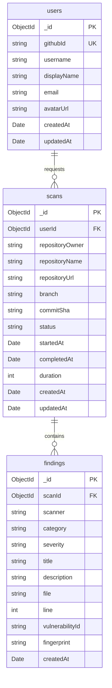

# DATABASE_DESIGN.md — SafeRepo

**Version:** 0.2.0  **Status:** Draft

---

## 1. Overview

SafeRepo uses MongoDB with Mongoose ODM.

- **Local:** MongoDB 7 via Docker (`docker-compose up -d`)
- **Production:** MongoDB Atlas (free tier M0)
- **ODM:** Mongoose

Not approved for MVP: PostgreSQL, Prisma, Redis.

---

## 2. Data Model

---

## 3. Collections

### users

Stores authenticated users (via GitHub OAuth).

| Field | Type | Constraints | Notes |
|-------|------|-------------|-------|
| _id | ObjectId | PK (auto) | |
| githubId | String | unique, required | GitHub user ID |
| username | String | required | GitHub username |
| displayName | String | | Display name from GitHub |
| email | String | | From GitHub profile (optional, PII) |
| avatarUrl | String | | GitHub avatar URL |
| createdAt | Date | default: Date.now | |
| updatedAt | Date | default: Date.now | |

> TBD — Session/token storage strategy requires architectural decision (JWT vs session-based).

### scans

Stores scan requests and their status.

| Field | Type | Constraints | Notes |
|-------|------|-------------|-------|
| _id | ObjectId | PK (auto) | |
| userId | ObjectId | required, ref: users | Who requested the scan |
| repositoryOwner | String | required | e.g., "facebook" |
| repositoryName | String | required | e.g., "react" |
| repositoryUrl | String | required | Full GitHub URL |
| branch | String | required | Branch scanned |
| commitSha | String | | Exact commit SHA (if available) |
| status | String | required, enum | "queued", "cloning", "scanning", "normalizing", "completed", "failed", "timed_out" |
| scanners | [String] | | Which scanners were run |
| summary | Object | | Aggregated counts by severity |
| summary.total | Number | | Total findings count |
| summary.critical | Number | | Critical severity count |
| summary.high | Number | | High severity count |
| summary.medium | Number | | Medium severity count |
| summary.low | Number | | Low severity count |
| summary.info | Number | | Informational count |
| error | String | | Error message if failed |
| startedAt | Date | | When scan execution began |
| completedAt | Date | | When scan finished |
| duration | Number | | Duration in milliseconds |
| createdAt | Date | default: Date.now | |
| updatedAt | Date | default: Date.now | |

### findings

Stores normalized security findings from all scanners.

| Field | Type | Constraints | Notes |
|-------|------|-------------|-------|
| _id | ObjectId | PK (auto) | |
| scanId | ObjectId | required, ref: scans | Parent scan |
| scanner | String | required | "semgrep", "trivy", "gitleaks", "osv", "npm-audit", "pip-audit" |
| category | String | required | "sast", "dependency", "secret", "configuration", "license" |
| severity | String | required | "critical", "high", "medium", "low", "info" |
| title | String | required | Short finding title |
| description | String | | Detailed explanation |
| file | String | | Affected file path (nullable for dependency findings) |
| line | Number | | Line number (nullable) |
| package | String | | Package name (for dependency findings) |
| packageVersion | String | | Vulnerable version |
| fixedVersion | String | | Fixed version (if known) |
| vulnerabilityId | String | | CVE, GHSA, or rule ID |
| remediation | String | | Suggested fix |
| fingerprint | String | required | Dedupe hash (scanner + file + line + ruleId) |
| metadata | Object | | Raw scanner-specific data (for reference) |
| createdAt | Date | default: Date.now | |

> **Secret redaction:** Findings from Gitleaks never store actual secret values. Only the file, line number, and secret type are recorded.

---

## 4. Indexes

| Collection | Index | Type | Notes |
|------------|-------|------|-------|
| users | githubId | unique | GitHub user lookup |
| scans | userId | regular | User's scan history |
| scans | status | regular | Queue/status queries |
| scans | { repositoryOwner, repositoryName } | compound | Repo-level queries |
| scans | createdAt | regular | Chronological listing |
| findings | scanId | regular | Findings per scan |
| findings | severity | regular | Severity filtering |
| findings | category | regular | Category filtering |
| findings | fingerprint | regular | Deduplication |
| findings | { scanId, scanner } | compound | Per-scanner breakdown |

---

## 5. ODM & Schema Definition

- **ODM:** Mongoose
- **Schema location:** TBD — Requires Phase 01 folder structure decision
- **Migrations:** Not required for initial setup (Mongoose creates collections on first write). For schema changes in production, use migration scripts in `scripts/migrations/`.

---

## 6. PII & Security

- **PII fields:** `users.email` — mask in logs, support GDPR deletion
- **Secret redaction:** Gitleaks findings never store discovered secret values
- **No plaintext credentials** in any collection
- **MongoDB connection:** TLS in production (Atlas enforces this by default)

---

## 7. Backup

- **Production:** MongoDB Atlas automated backups (M10+ clusters have point-in-time recovery). For free/shared tier: scheduled `mongodump` via cron or CI.
- **Local:** Docker volume `mongodata` persists data across container restarts.

---

## 8. Referential Integrity

MongoDB does not enforce foreign keys at the database level. Referential integrity is handled at the application layer:

- Deleting a user → application deletes all their scans and related findings
- Deleting a scan → application deletes all its findings
- Mongoose `pre('deleteOne')` and `pre('deleteMany')` middleware enforces cascade behavior

---

## 9. Open Schema Questions

> TBD — The following schema aspects require architectural decisions before finalization:

- Authentication token/session storage strategy
- Scan queue implementation (in-DB vs external queue)
- Scan history retention policy (how long to keep old scans)
- Maximum findings per scan (storage limits)
- Whether to store raw scanner output alongside normalized findings
