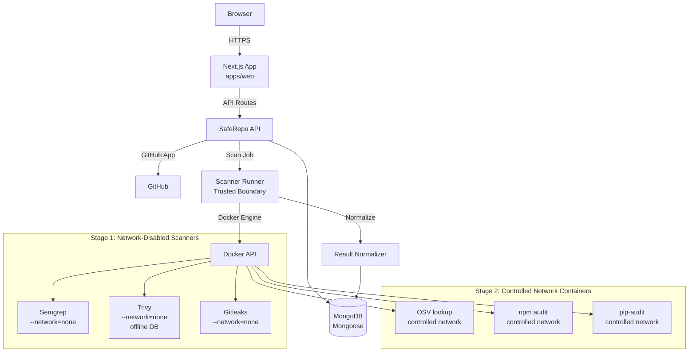

# SYSTEM_ARCHITECTURE.md — SafeRepo

**Version:** 0.4.1  **Status:** Draft  **Updated:** 2026-08-23

---

## 1. Overview Diagram



---

## 2. Tech Stack

| Layer | Tech | Why | Alternative |
|-------|------|-----|-------------|
| Frontend | Next.js 14 App Router + TS + Tailwind CSS | SSR, perf, DX | Vite |
| API | Next.js API routes + TypeScript + Zod | Collocated with frontend, typed, validated | Fastify |
| DB | MongoDB 7 (local Docker) / MongoDB Atlas (production) | Flexible document schema for scan findings | — |
| ODM | Mongoose | Schema validation, middleware, hooks | — |
| Scanners | Semgrep, Trivy, Gitleaks, OSV API, npm audit, pip-audit | Comprehensive security coverage | — |
| Scanner Isolation | Docker containers | Untrusted code isolation, resource limits | — |
| Auth | GitHub App + server-side sessions | Controlled repository access, secure session management | — |
| Tests | Vitest + Playwright | Unit/integration + E2E | Jest |

**ADRs:** ADR-001 MongoDB (supersedes original Postgres ADR)

Not approved for MVP: PostgreSQL, Prisma, Redis, S3.

---

## 3. Core Architecture — Local-First

SafeRepo is designed to be fully functional in a local Docker-based environment.

The security scanning functionality does not depend on any specific hosting provider.

### Primary Development Environment

```
Developer Machine
       ↓
SafeRepo Application (Next.js)
       ↓
Docker
├── MongoDB 7 (database)
└── Isolated Scanner Containers (per scan)
       ↓
Security Results → MongoDB → Dashboard
```

### Web Application (apps/web)

- Routes: `/`, `/login`, `/dashboard`, `/scan/:id`, `/repo/:owner/:name`
- Components: RepoSelector, ScanStatus, FindingsList, SeverityChart, RemediationPanel
- State: React Query for server state
- Auth: GitHub OAuth via GitHub App, server-side sessions (MongoDB-backed)

### Scanner Runner (Trusted Boundary)

The Scanner Runner is a dedicated component responsible for creating and managing scanner containers. It operates as a trusted boundary between the SafeRepo API and the Docker engine.

**Security boundary:** The Docker daemon is a highly privileged service. Docker socket access (`/var/run/docker.sock`) MUST NOT be mounted into:
- The web application container
- The API container
- Any scanner container
- Any container processing untrusted repository contents

Only the Scanner Runner has access to the Docker API. It enforces an explicit allowlist of:
- Scanner image (pinned, pre-approved)
- Command and arguments
- Mounts (read-only repository, tmpfs for temp)
- CPU, memory, and PID limits
- Timeout
- Network policy
- Filesystem policy

Repository contents MUST NEVER control Docker configuration directly.

### Scanner Service (services/scanner)

Logically separated from the web application.

- Receives scan requests from the API
- Clones/downloads repository safely (depth-limited, size-limited)
- Dispatches to the Scanner Runner for Docker-isolated execution
- Collects and normalizes results
- Stores findings in MongoDB

### Database (see DATABASE_DESIGN.md)

- Collections: users, scans, findings
- ODM: Mongoose with schema validation
- Local: MongoDB 7 via Docker
- Production: MongoDB Atlas

---

## 4. Data Flows

### Scan Request

```
User selects repository
       ↓
API validates request (auth, rate limit, input validation)
       ↓
Create scan record (status: "queued")
       ↓
Scanner service acquires repository (git clone --depth 1)
       ↓
Detect ecosystem (package.json → Node, requirements.txt → Python)
       ↓
Dispatch to Docker-isolated scanners
       ↓
Collect JSON output from each scanner
       ↓
Normalize findings into unified schema
       ↓
Redact secret values (Gitleaks)
       ↓
Store findings in MongoDB
       ↓
Update scan status to "completed"
       ↓
Dashboard displays results
```

---

## 5. Security Architecture

### Staged Scanner Execution

SafeRepo uses a staged scanning architecture with two distinct network policies.

#### Stage 1 — Network-Disabled Scanners

Static analysis and secret detection scanners execute with no network access. These scanners operate directly on repository source code.

**Scanners:** Semgrep, Gitleaks, Trivy (with pre-loaded offline vulnerability database)

Docker container restrictions:

- `--network=none` (no internet access)
- `--read-only` root filesystem
- `--tmpfs /tmp:rw,noexec,nosuid,size=64m` (writable temp, no execution)
- `--security-opt=no-new-privileges`
- `--cap-drop=ALL`
- `--memory=512m --cpus=1` (configurable per scanner)
- `--pids-limit=256`
- `--rm` (automatic cleanup)
- Timeout enforcement (configurable, default 300 seconds)

#### Stage 2 — Controlled Network (Dependency/Advisory Lookup)

Dependency and advisory analysis requires outbound HTTP access to public vulnerability databases. These scanners execute inside dedicated restricted containers with controlled outbound network access.

Dependency scanners MUST NOT execute directly on the developer/production host.

**Scanners:** OSV API (HTTP), npm audit (npm registry), pip-audit (PyPI)

Docker container restrictions:

- Controlled outbound network access (not `--network=none`, but restricted)
- `--read-only` root filesystem
- `--tmpfs /tmp:rw,noexec,nosuid,size=64m` (writable temp, no execution)
- `--security-opt=no-new-privileges`
- `--cap-drop=ALL`
- `--memory=512m --cpus=1`
- `--pids-limit=256`
- `--rm` (automatic cleanup)
- Timeout enforcement
- No Docker socket access
- Explicit outbound allowlisting where technically possible

Stage 2 containers:

- Query advisory APIs using extracted manifest data (e.g., `package-lock.json`, `requirements.txt`)
- NEVER execute repository code
- NEVER run arbitrary repository lifecycle scripts (`preinstall`, `postinstall`, etc.)
- NEVER perform unrestricted package installation
- Are still isolated from the host
- Have least privilege

### Docker Socket Security

The Docker daemon provides root-equivalent access. Docker socket access is restricted to the Scanner Runner boundary only.

**MUST NOT mount `/var/run/docker.sock` into:**
- Web application containers
- API containers
- Scanner containers
- Any container processing untrusted repository contents

The Scanner Runner enforces an explicit allowlist for all Docker API calls. Repository contents cannot influence Docker container configuration.

### Application Security

- Input validation with Zod at every API boundary
- Authentication via GitHub App (OAuth) with server-side sessions
- Server-side sessions: opaque session ID in Secure, HttpOnly cookie with appropriate SameSite policy
- Session state stored in MongoDB with expiration and revocation support
- GitHub tokens/credentials stored server-side only — never in localStorage or client-accessible storage
- Rate limiting on scan requests
- CORS whitelist
- Helmet security headers
- No secrets in logs or responses
- PII masked in logs
- Discovered secrets from scans are never stored in plain text

### Repository Safety

- Repositories are treated as untrusted input
- Never execute repository code, scripts, or lifecycle hooks
- Clone with `--depth 1` to limit history
- Enforce repository size limits
- Disallow symlinks pointing outside workspace

---

## 6. Scalability

- **Local development:** Single machine, Docker, MongoDB — handles development and testing
- **Beta (100 users):** Architecture to be determined in Phase 09 based on workload analysis
- **Bottleneck:** Scanner execution time — mitigated by scan queue, timeouts, and resource limits
- **Scanner and web/API may be separately hosted** in production to allow independent scaling

---

## 7. Trade-offs

| Decision | Trade-off | Mitigation |
|----------|-----------|------------|
| Local-first | More setup for user | Docker Compose automates local environment |
| Docker isolation | Overhead per scan | Reuse scanner images, limit concurrent scans |
| No Redis (MVP) | No distributed cache/rate-limit | In-memory rate limit sufficient for MVP scale |
| MongoDB | No native FK enforcement | Mongoose middleware handles cascade deletes |

---

## 8. Deployment Architecture (Phase 09)

Deployment platform decisions are deferred to Phase 09.

The architecture must support separation of:

```
Web/UI/API Layer
       ↓
Scan Orchestrator
       ↓
Scanner Runner (Trusted Boundary — Docker API access)
       ↓
Restricted Scanner Containers (no Docker socket)
       ↓
MongoDB (Atlas for production)
```

Vercel is one option for the web/API layer. It is not mandatory.

The scanner service requires Docker execution capability and must be evaluated separately.

Do not deploy anything without human approval.
